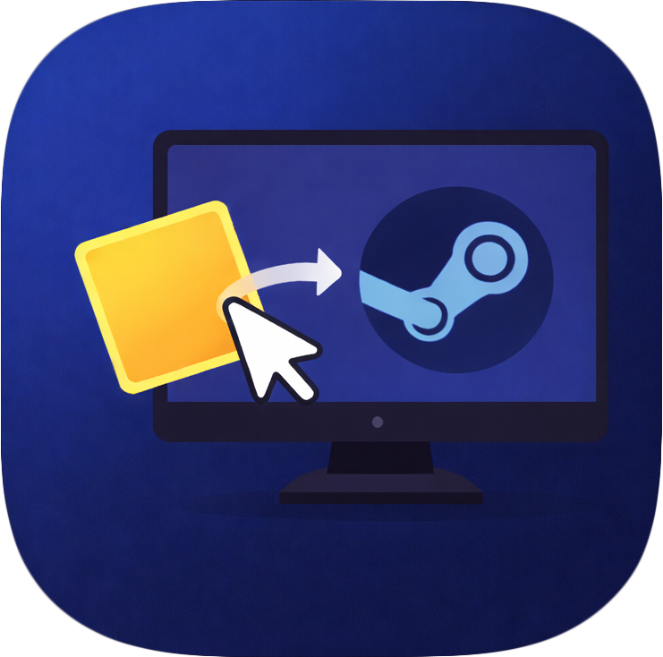
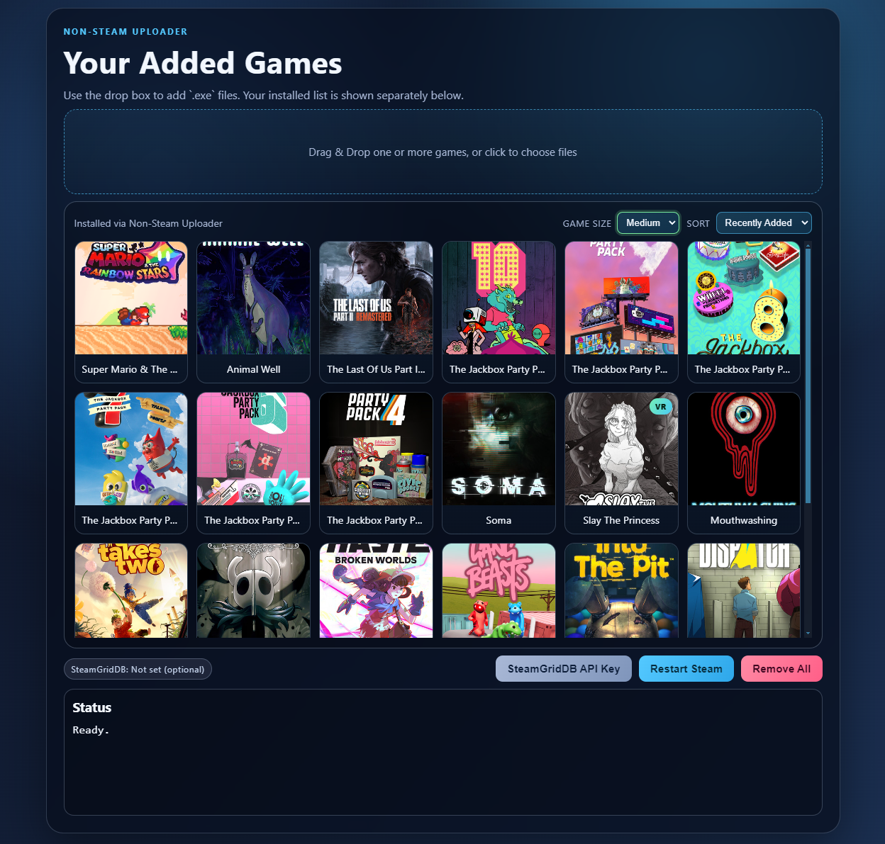

# Non-Steam Uploader 🎮



Add non-Steam games to your Steam library with artwork, fast management tools, and a clean desktop UI.

## Screenshot



## Features ✨

- Drag-and-drop support for `.exe` and `.lnk` files.
- Automatic Steam shortcut creation in the latest Steam user profile.
- Artwork: official Steam assets first, with optional SteamGridDB fallback.
- In-app SteamGridDB API key setup (with optional first-run prompt).
- Right-click actions: rename, delete, `VR Game` toggle, **Change Art** and **Save Sync**.
- Art picker: browse every official Steam / SteamGridDB image per slot (cover, wide, hero, logo) or use your own file.
- Cross-device save sync (PC <-> Steam Deck), like Steam Cloud for non-Steam games.
- Runs on Windows and Linux / Steam Deck (AppImage, Proton set automatically).
- Multi-select: `Ctrl/Cmd+Click` and `Shift+Click` range selection.
- Sorting options (recent, oldest, A-Z, Z-A, VR first).
- Game size presets (small / medium / large).
- One-click Steam restart button.
- Single-instance app lock (second launch focuses existing window).

## Requirements 🧩

- Windows or Linux (Steam Deck) with Steam installed.
- [rclone](https://rclone.org/downloads/) on each device, for save sync.
- Node.js 20+.

## Install & Run 🚀

```powershell
npm install
npm start
```

The app auto-reloads in development after file changes.

## How To Use 🕹️

1. Drag and drop one or more `.exe` / `.lnk` files into the app (or click to choose files).
2. Review games in the installed grid.
3. Right-click card(s) to rename, delete, or set VR flag.
4. Click `Restart Steam` after changes so Steam refreshes shortcuts/artwork.

## SteamGridDB API Key (Optional) 🔑

You can set or edit the key directly in the app from the `SteamGridDB API Key` button.

Get your key here:
https://www.steamgriddb.com/profile/preferences/api

## Save Sync ☁️

1. Click **Cloud Saves** and connect Google Drive / OneDrive / Dropbox (or type an existing rclone remote such as `gdrive:`). Do this on every device.
2. Right-click a game → **Save Sync...**. On the first device, pick the game's save folder (usually under `%APPDATA%`, `%LOCALAPPDATA%`, `LocalLow` or `Documents`, or inside the game folder).
3. On your other devices, add the same game **with the same name** and turn on Save Sync. The save folder is picked up from the cloud automatically.
4. Restart Steam. Launching the game from Steam now downloads the newest save first and uploads yours when you quit.

How it works:

- The shortcut launches the game through this app (`--nsu-wrap`). On Windows, the shortcut target becomes this app. On the Deck, the launch options become `"<AppImage>" --nsu-wrap <id> -- %command%` so Proton still applies. Keep the AppImage / exe where it is after enabling sync.
- Save folders are stored as portable paths (`{AppData}/Game/Saves`), which map to the shortcut's Proton prefix on the Deck.
- If both devices changed the save, you're asked which one to keep. Before any download overwrites local files, the local save is copied to `<app data>/save-backups/<game>/` (last 5 kept).
- Cloud layout: `<remote>non-steam-saves/<game-key>/{meta.json,files/}`.

Limits:

- On the Deck, the very first launch has no Proton prefix yet, so nothing is downloaded. When you quit, you're offered the cloud save.
- A game whose launcher exits immediately (the launcher starts the real game, then quits) gets backed up too early.
- Quitting from the Steam overlay in Game Mode can kill the wrapper before it uploads. Use the game's own quit option instead.
- Turn off sync before renaming a game (the cloud save is keyed on the name).

## Data Written By The App 🗂️

- `Steam\userdata\<userId>\config\shortcuts.vdf`
- `Steam\userdata\<userId>\config\grid\`
- Linux only: Proton `CompatToolMapping` entries in `Steam/config/config.vdf` (written by **Restart Steam** while Steam is closed)

Artwork filenames follow Steam grid conventions:

- `<shortcutId>.jpg` (landscape)
- `<shortcutId>p.jpg` (portrait)
- `<shortcutId>_hero.jpg`
- `<shortcutId>_logo.png`

## Build For Windows 🏗️

Build installer:

```powershell
npm run build:win
```

Build portable app:

```powershell
npm run build:win-portable
```

Output is generated in `dist\`.

## Build For Linux / Steam Deck 🐧

```bash
npm run build:linux
```

Copy the AppImage to the Deck, `chmod +x` it, and run it in Desktop Mode.
